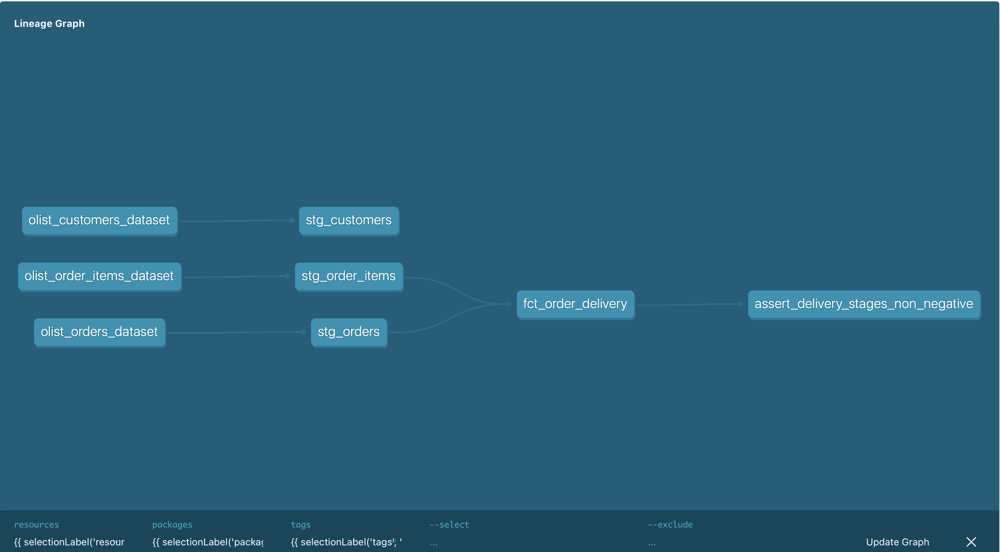

# Delivery Performance Analytics (dbt + DuckDB)

A layered dbt project over 96,446 e-commerce orders that measures delivery
performance against the estimate shown to the customer at purchase, and
decomposes elapsed time by stage so lateness can be attributed rather than
averaged away.

Built with dbt-core 1.12 and DuckDB. Runs locally with no cloud account.

## The finding

**93.2% of orders arrived on or before the promised date.** The interesting
part is the 6.8% that didn't.

| Stage | On-time orders | Late orders | Gap |
|---|---|---|---|
| Approval → carrier handoff | 2 days | 3 days | 1 |
| Carrier handoff → delivery | 7 days | **26 days** | **19** |
| **Purchase → delivery (total)** | **10 days** | **31 days** | **21** |

*(medians; 89,913 on-time vs 6,533 late orders)*

Late orders take 21 days longer end to end, and **19 of those days — about 90%
— are transit time**. Seller handoff contributes one day. Payment approval
contributes none.

The operational implication runs against intuition: when a delivery is late,
it is almost never because the seller was slow to ship. The parcel leaves
roughly on schedule and then spends three and a half weeks in the carrier
network. Chasing sellers would not move this metric; carrier performance,
routing, or the promise made at checkout would.

A headline on-time rate of 93.2% hides all of this. That is the reason the
fact model stores stage durations rather than only a total.

## Architecture



**Staging** (`models/staging/`, materialized as views) — one model per source
table. Renames and types only; no joins, no business logic. `stg_orders`
renames `order_delivered_carrier_date` to `handed_to_carrier_at` and
`order_delivered_customer_date` to `delivered_at`, because the originals are
easy to confuse and confusing them silently corrupts every transit metric.

**Marts** (`models/marts/`, materialized as tables) — `fct_order_delivery`
holds all business logic. One row per delivered order.

Views for staging, tables for marts: staging models are thin transformations
nobody queries directly, so persisting them wastes storage; marts are read
repeatedly, so the build cost is paid once.

## Grain

- `stg_orders` — one row per order
- `stg_customers` — one row per customer
- `stg_order_items` — **one row per item within an order** (`order_id` +
  `order_item_id`)
- `fct_order_delivery` — one row per delivered order

Order items are aggregated to order level in a CTE *before* the join. Without
that step an order containing three products would produce three rows and
every order count downstream would be inflated.

## Data quality

13 tests: `unique`, `not_null`, `accepted_values` and `relationships` as
generic tests in YAML, plus one singular test asserting that delivery stages
cannot take negative time.

That singular test initially failed on 694 of 96,470 rows. Investigating them
produced two different problems requiring two different decisions.

**674 rows: carrier handoff recorded before payment approval.** Sampling the
timestamps showed approvals clustering within seconds of 23:30 — `approved_at`
is written by a nightly batch process, not captured at the moment of approval,
so it can post-date the physical handoff. These rows are **flagged** via
`has_timestamp_anomaly` rather than dropped: the cause is known, the records
are otherwise valid, and consumers can exclude them when stage durations
matter. This does not affect the headline finding, which rests on transit time.

**20 rows: delivery recorded before carrier handoff.** Physically impossible
and unexplained. These are **excluded** in the fact model with the reason in a
comment, because any transit figure derived from them is meaningless and
leaving them in silently distorts every average downstream.

Both decisions are visible in the code rather than held in someone's head.

## Running it

```bash
python3 -m venv venv && source venv/bin/activate
pip install -r requirements.txt

# place the Olist CSVs in seeds/ (see below)
dbt seed
dbt run
dbt test
dbt docs generate && dbt docs serve
```

**Data:** Brazilian E-Commerce Public Dataset by Olist (Kaggle,
`olistbr/brazilian-ecommerce`). Place `olist_orders_dataset.csv`,
`olist_order_items_dataset.csv` and `olist_customers_dataset.csv` in `seeds/`.
Seeds are used here for portability; in production this data would arrive via
an ingestion tool and be declared as sources.

## Next steps

- Incremental materialization on `fct_order_delivery` — full rebuild is fine at
  100k rows, not at 100M
- Snapshots on seller and customer attributes to track change over time
- A daily aggregate model for dashboard consumption
- Geographic breakdown using customer state, to test whether transit delay
  concentrates in specific regions
- `dbt test` in CI on every pull request
